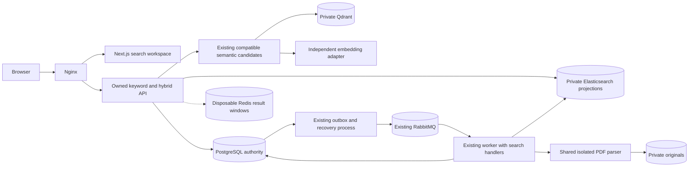

# Phase 5 T01 — Advanced keyword and hybrid search

Status: **T01–T10 candidate code implemented; T11 acceptance PARTIAL, decision NOT READY. Mandatory live, quality/resource and reviewed-candidate CI gates remain open.**

Current [T11 matrix and continuation checkpoint](phase-5-verification.md) distinguish
implemented code from accepted functionality. The requirements and dated T01 audit
below remain the approved baseline, not a declaration that all gates passed.
The owner-requested [T12 manual handoff](phase-5-manual-git-handoff.md) rechecks
unchanged evidence and records owner-only Git instructions without extending scope.
Planning date: **13 October 2026**. Target: **v1.4.0**, subject to compatible
implementation and acceptance. `VERSION` remains `1.3.1`; a target is not a release.

[Documentation index](README.md) | [Roadmap](roadmap.md) |
[Projection ADR](decisions/ADR-007-rebuildable-keyword-search.md) |
[Hybrid ranking ADR](decisions/ADR-008-cross-index-hybrid-ranking.md)

This is the canonical Phase 5 scope, architecture, task plan, acceptance criteria
and testing strategy. The [T02 implementation](phase-5-data-foundation.md) records
installed SQL names/schema and v3 contracts. T03 implements enrollment/fencing. [T04 private transport](phase-5-elasticsearch.md)
and [T05 lexical publication](phase-5-lexical-publication.md) are implemented with
live acceptance pending. [T06 keyword API](phase-5-keyword-search.md) implements the
keyword route; T07 implements cursor continuation and hybrid document fusion.
T08–T10 implement evidence, frontend and operations with live acceptance pending.
Generated OpenAPI and migrations own implemented details. ADR-007/008 are accepted
for implementation; their acceptance status does not certify the remaining live gates.
The [T03 implementation and verification](phase-5-search-enrollment.md) records the
current lifecycle hooks, canonical metadata fence and durable handoff boundaries.

## Current baseline and audit evidence

Inspection used the clean local `v1.4.0` branch at `d86395f` (`update color theme`).
Recent history includes `497e6ce` (`v1.3.1 update`) and `358edf9`
(`chore(release): prepare Qyvra v1.3.1`). The only local tag is `v1.1.0`.
Root VERSION is `1.3.1`; no newer accepted release was found. A branch name does
not establish release status. Remote tags, final-commit CI and publication were
not queried. The baseline is the implemented **v1.3.1 prepared candidate**, whose
recorded readiness is **CONDITIONALLY READY** for the pinned local-provider pair.

Read root/application AGENTS, README, the documentation index, specification,
architecture, database/API guides, roadmap, development/testing conventions,
ADRs, historical release/acceptance records and local-provider preparation/review.
Code evidence overrides old planning descriptions; verification below means
inspection plus identified historical evidence, not tests executed by T01.

| Capability                                                                                                   | Classification                                                    | Repository evidence and limits                                                                                                                                                                                                                                                                                                      |
| ------------------------------------------------------------------------------------------------------------ | ----------------------------------------------------------------- | ----------------------------------------------------------------------------------------------------------------------------------------------------------------------------------------------------------------------------------------------------------------------------------------------------------------------------------- |
| Accounts, private document CRUD, metadata filters, categories/tags, immutable versions, upload/download      | Implemented; historical acceptance recorded                       | `apps/api/src/modules/{auth,documents,categories,tags}`, `apps/web/features/documents`, private storage package; [Phase 1 snapshot](releases/v1.0.0.md), [Phase 2 snapshot](releases/v1.1.0.md). Catalog `q` is metadata substring matching, not full text.                                                                         |
| Durable jobs, outbox, independent worker, RabbitMQ, integrity checks, retries and progress                   | Implemented; historical real-infrastructure verification recorded | `packages/database/src/processing*.ts`, `apps/api/src/infrastructure/{outbox,messaging,worker,progress}`, worker/outbox entry points; [Phase 3 acceptance](phase-3-acceptance.md). Worker is a separate process inside the API package, not an `apps/*-worker` package.                                                             |
| PDF extraction, deterministic chunks, embeddings, Qdrant activation/cleanup, ingestion/reprocessing/backfill | Implemented; recorded Phase 4 acceptance                          | Worker handlers, `packages/database/src/{ai,ai-scheduling,processing-pipeline}.ts`, shared Prisma/migrations; [Phase 4 verification](phase-4-verification.md). Text-bearing PDFs only; no OCR.                                                                                                                                      |
| Semantic retrieval, grounded Q&A and exact source reads                                                      | Implemented; recorded security/browser verification               | `modules/search/semantic-search.{service,repository,controller}.ts`, `modules/ai/rag-answer.service.ts`, source controller and web `features/ai`; SQL validates exact candidate tuples/current owned versions.                                                                                                                      |
| Native Ollama and compatible cloud providers                                                                 | Implemented; qualified verification                               | `infrastructure/{embeddings,generation}` factories/adapters; [v1.3.1 snapshot](releases/v1.3.1.md), [T05 evidence](local-provider-verification.md). Real Nomic/Qwen pair verified in that record; paid OpenAI application inference and arbitrary local models are unverified.                                                      |
| CI validation                                                                                                | Implemented workflow; latest remote result not established here   | `.github/workflows/phase-four.yml` installs locked packages, builds, checks types/lint/audits and runs deterministic plus PostgreSQL/Qdrant/RabbitMQ/Redis tests. Browser fault tests are opt-in. [T07 review](local-provider-release-candidate-review.md) records a failed earlier CI gate and remediation, not a new T01 CI pass. |
| Elasticsearch, keyword content search, hybrid ranking, highlights, autocomplete                              | Planned; not implemented                                          | No Elasticsearch service/client/search handler in current Compose or package manifests. Semantic endpoint is `/api/v1/search/semantic`; no lexical/hybrid counterpart.                                                                                                                                                              |
| Release automation, production rollback certification, full accessibility audit                              | Incomplete operational coverage, not completed features           | Candidate snapshots and acceptance ledgers retain these limits. Local static checks or a workflow file do not prove a published/production release.                                                                                                                                                                                 |
| Older broad MVP/phase descriptions and absent-worker/broker guidance                                         | Superseded as current inventory, preserved historically           | Specification and some agent-file descriptions retain v1.0.0 context. Narrowed Phase 3/4 guides and actual AppModule/worker/Compose govern the baseline. ADR-006's earlier live-unverified text is qualified by subsequent T05; it is not rewritten here.                                                                           |
| OCR, summaries/classification, reminders, permanent purge, persistent chat, streaming, agents, Keycloak      | Deferred or outside this phase                                    | Broad specification targets are not installed features. Phase 6 retains the identity direction; no Phase 5 commitment to these capabilities.                                                                                                                                                                                        |

The audited v1.3.1 baseline has 15 migration directories; T02 adds the 16th.
T03 adds the 17th canonical metadata/publication guard migration without backfill.
PostgreSQL stores owned versions,
canonical extraction, complete chunk sets/chunks, immutable profiles/checkpoints,
AI runs and ready-index pointers. Originals use private storage. RabbitMQ carries
identifiers; Redis progress is disposable; Qdrant is rebuildable. Nginx alone
publishes the browser port; Elasticsearch has no current network/volume/service.

Important code constraints discovered:

- `ProcessingJob.documentVersionId` is required. Existing SQL partial uniqueness,
  dependency/ownership checks and job type constraints must be extended deliberately.
- `processing-pipeline.ts` currently schedules a linear AI-run chain from verified
  files through extraction, chunks, embeddings and vectors. Eligibility requires
  the desired BUILDING AI run for those stages.
- `PdfTextExtractionHandler` requires an AI run and completed integrity predecessor.
  Keyword extraction cannot be enabled simply by turning on AI ingestion.
- `SemanticSearchService` caps returned chunks at 20, oversamples at most 100,
  validates serving fingerprints, caps manifest scope and rehydrates SQL tuples.
  Hybrid search must not call its public top-20 method and pretend it received a
  full candidate pool. RAG calls its public search/revalidation boundaries today.
- Metadata PATCH changes SQL but creates no keyword projection intent. Lifecycle
  processing cancellation currently knows vector cleanup, not Elasticsearch.

## Objective and scope

The approved [roadmap](roadmap.md#later-phases-and-earlier-planning-directions)
names Phase 5 **Advanced keyword and hybrid search: Elasticsearch, highlights,
autocomplete and ranking**. [Specification](specification.md) F-12/F-13 and its
search/security sections corroborate keyword plus semantic retrieval with ownership
filters. No replacement phase theme is proposed.

**Objective:** find private current-version documents by exact identifiers,
metadata, phrases and PDF text, or combine lexical and semantic relevance, with
safe highlights and authorized source navigation. This follows the existing
canonical text, durable processing and semantic retrieval foundation.

| Scope category                     | Planned commitment                                                                                                                                                                                                                                                                              |
| ---------------------------------- | ----------------------------------------------------------------------------------------------------------------------------------------------------------------------------------------------------------------------------------------------------------------------------------------------- |
| Must have                          | Owner-scoped keyword search, exact-reference and phrase matching, filters, deterministic ranked document results, safe snippets, bounded title/reference/issuer autocomplete, hybrid fusion with existing Qdrant, current-version navigation.                                                   |
| Supporting infrastructure          | Optional private Elasticsearch deployment; typed adapter; PostgreSQL publication/revision state; existing worker/outbox extensions; model-independent PDF extraction enrollment; backfill, rebuild, cleanup, reconciliation and observability; isolated service/CI verification.                |
| Optional after required acceptance | Calibrated bounded typo tolerance, language-specific analyzers and alternate boost presets. These require measured benefit and cannot silently change exact identifier semantics.                                                                                                               |
| Explicit exclusions                | OCR/new file formats, historical-version search, archived-document search, global suggestions/query history, exact global hit counts/facets, arbitrary query DSL, learned or LLM reranking, automatic hybrid RAG, public search-service ports, new broker/worker framework, cloud provisioning. |
| Deferred                           | Keycloak/teams/tenants, chat/streaming/agents/MCP/Hermes, LangChain/LangGraph, model downloads/GPU management, reminders, summaries/classification, bulk operations and permanent purge.                                                                                                        |

Search covers active, non-deleted current versions. PDF metadata becomes searchable
before extraction; extracted text is added when verified canonical pages are ready.
JPEG/PNG remain metadata-only; scanned/empty PDFs show explicit unavailable-text
coverage, not invented extracted content. Legacy documents without a file version
remain available through the catalog; advanced indexing of those records is
excluded to preserve version-bound job constraints. This is a proposed scope
narrowing, not evidence that metadata-only catalog records disappear.

Category/tag **IDs** filter results. Their names are not indexed search text or
autocomplete suggestions in the first slice, avoiding unnecessary rename fanout.
The catalog retains its current archived behavior, substring query and cursors.
The new search experience defaults to active records only.

## Proposed architecture

### Backend and domain boundaries

Extend existing `modules/search` with keyword and hybrid application services,
validated DTOs/controllers, ranking and canonical SQL hydration. Define a narrow
`KeywordSearchStore` interface for candidate search, suggestions, bounded bulk
publication/verification and generation cleanup; the Elasticsearch transport lives
under `infrastructure/search`. Domain rules never import an Elasticsearch SDK.
Native HTTP is the initial recommendation, matching existing provider patterns;
select a pinned official client only if transport needs justify it in T04.

Add a search-enrollment boundary callable inside existing document transactions.
It creates desired revisions/jobs/outbox intents without remote I/O. Worker search
handlers own projection building, extraction reuse and index publication. Existing
claim/lease/retry/recovery handles their lifecycle. Retain AppModule HTTP separation
from WorkerModule and OutboxModule; add no new worker package or job engine.

Expose a bounded semantic-candidate boundary within SearchModule in T07. It takes
trusted owner context, validated metadata/document filters, cancellation and a
server-owned candidate budget. Preserve the current semantic response limits,
min-score/profile rules, manifest cap, authorization, and RAG call behavior.
Do not bypass SQL hydration to get more Qdrant results.

### PostgreSQL and projection ownership

Names are proposed logical entities; T02 owns exact Prisma and SQL design:

| Entity/extension          | Purpose and constraints                                                                                                                                                                                                                                                                                                                 |
| ------------------------- | --------------------------------------------------------------------------------------------------------------------------------------------------------------------------------------------------------------------------------------------------------------------------------------------------------------------------------------- |
| `SearchIndexGeneration`   | Versioned mapping/analyzer/extractor fingerprint, physical index names and BUILDING/SERVING/RETIRED state. One serving generation selected in SQL. No secrets or arbitrary URLs stored here.                                                                                                                                            |
| `DocumentSearchState`     | One owner-bound document row with monotonic desired revision and current desired version. Revision advances on indexed metadata, association, version or lifecycle changes. SQL pointer to an eligible published projection; timestamps alone are insufficient fences.                                                                  |
| `VersionSearchProjection` | Owned document/version/generation/revision manifest, canonical extraction reference if present, metadata hash, expected record IDs/count/hash and BUILDING/READY/REMOVAL_PENDING/REMOVED/FAILED state. Separate metadata readiness and text coverage. Composite ownership foreign keys and unique version/generation/revision identity. |
| `SearchProjectionChange`  | Durable bounded fanout checkpoint for organization association deletion affecting many documents. Same SQL transaction as category/tag deletion; records owner, change identity and scan cursor. Recovery creates ordinary version-bound jobs in batches. No second broker or persistent scheduler.                                     |
| Existing jobs/outbox      | New search projection reference and version-bound INDEX_SEARCH, EXTRACT_SEARCH_TEXT and REMOVE_SEARCH_INDEX types; preserve all existing relationships and required version identity. Update SQL-only checks/uniqueness, not just Prisma.                                                                                               |

No originals, embeddings or competing canonical text copy are stored in these
entities. `ExtractedText` already has version/extraction fingerprint uniqueness,
owned lineage, canonical text/hash and page spans independent of profile storage.
Reuse it. Shared extraction computation/publication must allow both AI and search
requests to converge on one immutable artifact, verifying hashes if a unique-key
race occurs. An AI run is not created to satisfy a lexical request.

Elasticsearch uses explicit mappings, not dynamic arbitrary metadata. In each
generation, maintain a metadata record per projection and bounded canonical-page
records for text-bearing PDFs. Fields include trusted user/document/version,
projection/revision, source hash, page identity and filter metadata. Text fields
cover title, description, issuer, reference and current filename; reference also
gets a normalized exact field preserving meaningful punctuation. Tag/category
names, raw file paths, credentials, binaries and vectors are excluded.

Page records reference canonical extraction offsets and page numbers; they do
not create a second chunk algorithm or require a model tokenizer. Page text can
be subdivided into deterministic bounded segments for large pages, retaining
page-relative and canonical scalar offsets. Projection identity includes the
segmentation version. Define size/count ceilings before T04 publication.

### Transactions, messaging and stage orchestration

1. Under the existing owned document lock, a mutation updates SQL, increments the
   desired search revision, revokes incompatible publication and creates a job
   plus outbox intent. Upload receipts/version scheduling stay in their existing
   transaction. No HTTP request calls Elasticsearch or parses PDFs.
2. Existing dispatcher publishes identifiers. Introduce schema **v3** for new
   search job vocabulary; retain readers for v1/v2 and all required version IDs.
   No text, vectors, secrets or client-supplied ownership enters envelopes.
3. Worker claims a leased job, loads trusted SQL lineage, builds a bounded metadata
   projection and writes it outside a SQL transaction. Verify per-item bulk
   results, record identities/hashes and search visibility before publication.
4. A short SQL transaction checks lease token, attempt, generation, current version,
   desired revision and lifecycle before switching the ready pointer. Duplicate
   messages repeat identical writes; a superseded worker cannot publish READY.
5. For enabled PDF text coverage, wait for completed file verification, reuse the
   matching extraction or schedule EXTRACT_SEARCH_TEXT. Share the isolated parser
   and artifact commit logic with EXTRACT_TEXT while preserving the AI run checks
   on the existing AI entry point. Publish a new complete projection with text.
   Keyword work does not continue into chunks/embeddings/vectors.

Do not replace the AI chain's single-successor map with a lexical stage wedged
between existing stages. Add explicit search branch scheduling and dependencies,
using the same ProcessingRepository transaction/lease/outcome primitives. Job
status views must distinguish metadata indexing, PDF text coverage and AI readiness.
Keyword extraction limits and terminal failure categories mirror existing PDF
integrity/parser guards. A text failure may retain a valid metadata projection;
it must remain visible as partial coverage rather than falsely READY full text.

Removal jobs can run for archived/deleted/superseded resources without using the
active-document eligibility predicate. They delete exact retired projection IDs
in the server-selected generation, never an entire shared index by owner input.
Immutable per-revision record IDs keep late writes isolated; compare-and-swap SQL
publication plus reconciliation protects against abandoned remote records.
Bound retained generations/orphans so oversampling cannot become a permanent fix
for unbounded stale records.

### Lifecycle, fanout and index maintenance

| Trigger                                   | Required behavior                                                                                                                                                                                                                                                         |
| ----------------------------------------- | ------------------------------------------------------------------------------------------------------------------------------------------------------------------------------------------------------------------------------------------------------------------------- |
| Metadata or document-tag association edit | Atomically advance desired revision; retire old visibility; enqueue newest metadata/text projection using retained extraction. No embedding regeneration.                                                                                                                 |
| New version                               | Existing receipt/integrity/AI behavior preserved; old search pointer revoked in transaction; enroll new metadata projection. Historical versions cannot leak into current search.                                                                                         |
| Archive/soft delete                       | Revoke visibility immediately in SQL, cancel unfinished build/extraction work, retain/schedule removal independently of cancellation. Retrieval rejects stale remote hits before returning metadata/text.                                                                 |
| Restore                                   | Recheck current active version; advance revision; reuse compatible retained extraction and rebuild verified projection. Never reactivate an unverified old remote pointer.                                                                                                |
| Category/tag rename                       | No reindex because indexed filters use IDs and suggestions omit these names. UI labels come from canonical owned organization reads.                                                                                                                                      |
| Category/tag deletion                     | Commit association changes plus fanout checkpoint. Scan owner documents by bounded keyset and compare canonical membership hashes, advancing affected revisions and scheduling jobs. SQL filter/membership revalidation applies immediately, including during fanout lag. |
| Backfill                                  | Operator-only dry-run and bounded current-version cursor; eligibility/desired revision rechecked under lock; no historical version enrollment or model download.                                                                                                          |
| Rebuild/mapping change                    | Build new generation from SQL metadata/canonical extraction, reconcile mutations during build, verify current revisions and coverage, then SQL serving-pointer cutover. Never copy Elasticsearch as the only source of truth.                                             |
| Lost index/late worker/restart            | Reconciliation compares SQL READY manifests with remote IDs/hashes/visibility; invalidates missing projections and enqueues bounded repair. Parser is needed only if canonical extraction is absent; no embedding calls for lexical repair.                               |

Fanout reconciliation must inspect current SQL association hashes, not assume
`documents.updatedAt` changes when foreign-key actions alter associations. Retain
durable change checkpoints until a full bounded scan succeeds. Coalesce obsolete
builds to the newest revision without skipping cleanup. Test edits/deletes concurrent
with rebuild cutover; use a SQL generation fence and recheck mutations since scan
start before serving. A shadow generation is not READY merely because a scan ended.

### Infrastructure and configuration

Elasticsearch is the one justified additional runtime dependency: it delivers
roadmap keyword relevance, phrase matching, highlighting and prefix retrieval.
T01 adds/deploys no service. T04 should provide an optional Compose search override
with a private network, persistent named derived-data volume, heap/memory/CPU limits,
healthcheck, pinned tested image and explicit credentials. No Nginx route or host
port. API/worker access only; no browser or provider gets search credentials.
Outbox publishes without Elasticsearch access.

Choose the supported Elasticsearch release, image digest, authentication/TLS and
license requirements at T04 from current official documentation and record the
tested matrix; T01 does not invent a certified version. Use basic lexical features
and application-side fusion, not Elastic-hosted embeddings or built-in fusion
that would replace Qdrant. Trusted private HTTP may be permitted only in the
isolated documented local topology; remote deployments require authenticated TLS.

Add validated server-only search enrollment/serving flags, endpoint/credential,
mapping fingerprint, request/response/bulk limits, timeout, concurrency, candidate
scope, suggestion budget and retry limits. Flags default off; reject invalid
enabled configuration at startup. Runtime optional-index failures do not make
CRUD/downloads/independent AI paths depend on Elasticsearch health. Update
`.env.example` and environment/Compose guides when implemented; preserve volume
names and existing database secrets. Redis remains disposable progress and,
for new paginated search only, bounded expiring result windows.

### AI and RAG compatibility

Keyword metadata/PDF extraction and autocomplete must work with AI ingestion,
embedding, generation and Qdrant disabled. They never contact OpenAI/Ollama.
Hybrid needs only query embeddings and compatible Qdrant, plus lexical serving;
it does not require a generation provider. Keep independent adapter factories,
immutable embedding identity, tokenizer/input limits and profile checks unchanged.
No comparison of different profile vectors and no reuse merely by dimensions.

OpenAI-compatible/Ollama embedding combinations must pass deterministic regression
tests. Retain Qwen generation framing, thinking policy, context/output limits and
strict citations in existing RAG. **RAG remains semantic by default and unchanged**;
feeding hybrid results into answer context is deferred because ranking scores,
page records and metadata records are not current citation inputs. Existing
prompt-injection handling, pre-generation/pre-publication authorization and canonical
source-token validation remain mandatory. No new model, orchestration framework,
reranker or provider endpoint setting is introduced by lexical search.

## Proposed API and frontend contracts

Use additive `/api/v1/search/keyword`, `/api/v1/search/hybrid` and
`/api/v1/search/suggestions` POST operations, session authentication, existing
Origin/CSRF header rules, no-store envelopes and strict DTO rejection of unknown
fields. No public endpoint exists until the corresponding implementation task.

| Input         | Proposed validation and behavior                                                                                                                                                                                                                                                                                                  |
| ------------- | --------------------------------------------------------------------------------------------------------------------------------------------------------------------------------------------------------------------------------------------------------------------------------------------------------------------------------- |
| `query`       | Trimmed nonblank plain text, at most 4,000 UTF-16 units for keyword/hybrid; reject malformed surrogates/control characters. Hybrid still obeys selected embedding input limits. No query_string DSL, arbitrary fields, scripts, wildcards or index names.                                                                         |
| `match`       | Keyword allow-list `terms` or `phrase`; exact reference boost is server-defined. Hybrid lexical leg uses the same rule. No client ranking weights.                                                                                                                                                                                |
| `limit`       | Documents per page, default 10, range 1–20. Candidate budgets independent of page size.                                                                                                                                                                                                                                           |
| `documentIds` | Optional 1–50 distinct UUIDs, all authorized active current-version documents; foreign/missing/deleted/archived IDs share 404 behavior.                                                                                                                                                                                           |
| `filters`     | Explicit category UUID, all-of up to 10 tag UUIDs, document type/status, document/expiration/created/updated UTC date ranges, current MIME and bounded filename substring. Reuse catalog validation and semantics where applicable; exclude ARCHIVED/DELETING for advanced search. Foreign category/tag filters yield no matches. |
| `cursor`      | Optional opaque owner/session-bound result-window continuation; binds normalized input, mode, ranking version, serving index/profile and fixed candidate budget. Cannot change filters/query/limit mid-window.                                                                                                                    |
| Suggestions   | Prefix 2–200 units, limit 1–10; title/reference/issuer only, same active-owner/filter rules. No global vocabulary, query history or extracted-body suggestions.                                                                                                                                                                   |

SQL selects bounded eligible projection/version scopes and canonical metadata
filters **before** each engine queries. ES uses a mandatory authenticated `userId`
term filter plus serving generation/revision/version scope; Qdrant retains
user/profile/ready-manifest filters and the same filtered document scope. Both
legs must apply the same filters before top candidates are selected. Reject
oversized scope with a safe instruction to narrow filters; never silently search
an arbitrary subset of an owner's vault.

Return at most 20 **document** results, deduplicated by current document/version.
Each has canonical metadata and a discriminated metadata/page/chunk match, a
labelled ranking kind, matched fields and bounded canonical snippet segments.
Metadata matches have no fake page/chunk ID. Page matches carry extraction/page
and scalar offsets; semantic matches preserve exact chunk set/chunk lineage and
profile/manifest. Provide up to three representative authorized matches per
document. Fusion score is not a cosine score, probability or confidence.

Response coverage describes ready metadata versus full-text coverage without
revealing private service URLs. A valid empty eligible scope yields 200/empty;
disabled/unavailable backend is 503, not empty; validation 400, auth 401/403,
foreign explicit document scope 404, admission 429 and deadline 504. Reject failed
shards, timed-out/partial search responses and malformed hits instead of hiding
failures as complete results. Unexpected SQL failures follow existing safe 500
mapping. Existing catalog and semantic/RAG response shapes remain unchanged.

### Ranking and bounded pagination

Lexical leg combines metadata BM25 and canonical page matching, with server-owned
exact-reference/phrase boosts. Collapse multiple metadata/page hits into a single
document rank; use its highest eligible match score plus deterministic document
UUID ties. Semantic leg groups authorized chunks into document rank using its
highest eligible cosine score. A long document cannot gain rank solely by having
many chunks. Select representative matches separately from document ranking.

Recommend **application-side reciprocal rank fusion**:
`score(d) = sum(1 / (60 + rank_leg(d)))`, with ranks starting at one and absent
legs contributing zero. Start with equal weights and a fixed per-leg window of
100 documents, subject to T07 evaluation and hard scope/response caps. Use stable
UUID ties. Retrieve candidates in bounded batches up to a separate raw-hit cap;
if duplicate page/chunk hits exhaust that cap, report truncated coverage rather
than claim 100 distinct documents were examined.

| Approach                          | Assessment                                                                                                                                               |
| --------------------------------- | -------------------------------------------------------------------------------------------------------------------------------------------------------- |
| Raw BM25 plus cosine weighted sum | Rejected initial default: unrelated score scales and model/corpus calibration burden.                                                                    |
| Normalized score fusion           | Possible later: needs stable normalization and labelled quality evidence; small/flat windows are unstable.                                               |
| Reciprocal rank fusion            | Recommended: combines independent ranks without treating lexical and vector scores as commensurate; simple deterministic application logic keeps Qdrant. |
| Cross-encoder/LLM reranking       | Deferred: new runtime, cost/latency/model/privacy and evaluation requirements beyond the roadmap slice.                                                  |

RRF's rank-based combination and fixed-window considerations are supported by
[Elastic's RRF reference](https://www.elastic.co/docs/reference/elasticsearch/rest-apis/reciprocal-rank-fusion).
Our cross-engine document grouping and application-side implementation are design
recommendations, not a claim that Elastic's retriever queries Qdrant.

Pagination traverses the **fixed ranked window**, not a fresh fusion on every page
or a deep exhaustive vault scan. Store only authorized candidate IDs, revisions,
ranks and query/filter digests in an owner/session-bound Redis window with proposed
five-minute TTL, at most 200 documents and hard per-user/global memory limits.
Cursor is random/opaque; neither raw queries nor snippets are retained. Every page
rehydrates SQL identities, checks current serving/profile selection and filters,
and rejects/omits revoked records before snippets. Never cache authorization or
return cached text. Do not refill/rerank midway; follow stored ranks without duplicates.

Expired/evicted windows or changed serving/profile selection return a safe 409
restart-search response. First-page Redis failure may return its bounded results
with `paginationAvailable: false`, `nextCursor: null` and `truncated` where needed;
continuation failure returns 503. Window exhaustion is not an exact total count.
The existing API's CRUD and semantic paths remain usable during Redis failure.
No ES PIT is retained across independent Qdrant queries. This disposable window
supports stable ordering, not a transaction snapshot of content/lifecycle.

Hybrid default is strict: either leg's dependency failure fails the request with
503/504; a healthy leg with no eligible matches is not a dependency failure.
Do not silently call lexical-only results hybrid. The UI can explicitly offer
keyword mode after an embedding/Qdrant failure. No automatic fallback RAG behavior.

### Highlights, autocomplete and source reads

ES highlights are untrusted presentation hints, never canonical content or proof
of boolean-query truth. Verify candidate tuples, projection revision and source
hash in SQL before any display. Parse bounded highlight hints into offsets only
after matching their underlying fragment to the authorized canonical field/page;
discard ambiguous, malformed or stale hints and return a plain canonical excerpt.
Use scalar half-open offsets with explicit UTF-16 conversion tests. Return plain
text segments with `matched` flags; React uses escaped text and `<mark>`, never
`dangerouslySetInnerHTML`. Literal document marker strings, HTML and scripts must
remain harmless. [Elastic highlighting guidance](https://www.elastic.co/docs/reference/elasticsearch/rest-apis/highlighting)
documents that highlighted terms need not reflect full boolean query logic.

Autocomplete is an ordinary owner-filtered bounded prefix query over metadata
records, followed by SQL hydration/revalidation before returning canonical text.
Evaluate `search_as_you_type` with bool-prefix matching in T04;
[the official field reference](https://www.elastic.co/docs/reference/elasticsearch/mapping-reference/search-as-you-type)
describes its prefix/infix support. Avoid unfiltered completion dictionaries,
terms aggregations or spell suggestions that can reveal other owners' vocabulary.

Add an owned read-only page-source endpoint under documents/version/extraction/page
for lexical page matches; exact spelling and DTO belong to T08/OpenAPI. It returns
bounded canonical segments and scalar offsets, no storage keys/raw remote text.
Session guards, trusted lineage, strict UUID/page bounds and indistinguishable
unavailable/foreign 404s apply. Permit retained historical canonical sources for
an already issued source reference, matching the existing chunk-source policy;
do not make historical versions discoverable in new search. Reject deleted,
archived and DELETING parent documents, matching the inspected
`CitationSourceService` policy; preserve existing chunk-source behavior.
Large pages use bounded segment navigation rather than unrestricted full extraction
export. Current-file download is not a historical-file viewer.

### Frontend

Add a protected `/search` workspace using `app` route composition,
`features/search` behavior and `lib/api/search.ts` transport/schema validation.
Reuse organization selectors, design primitives, current document links and exact
chunk-source components. Preserve `/documents` and existing AI Search/Q&A route
and request behavior; navigation can expose the new workspace separately.

Modes: Keyword and Hybrid; semantic-only remains available in the existing AI
workspace. Show active filters, loading/cancellation, no matches, index-building
or metadata-only coverage, expired-window restart, explicit unavailable/rate-limit
errors and next-page state. A query/mode/filter change cancels in-flight work and
clears cursors; reject late responses and clear owner-specific state on logout or
account switch. Suggestions debounce, cancel and obey accessible combobox keyboard
interaction, status announcements and focus restoration. Test small screens,
Light/Dark/System, labels, loading announcements and `<mark>` contrast. Users see
search modes/coverage, not infrastructure settings or API keys.

## Compatibility and rollout

| Existing behavior             | Preservation rule                                                                                                                                                                          |
| ----------------------------- | ------------------------------------------------------------------------------------------------------------------------------------------------------------------------------------------ |
| Document CRUD/categories/tags | Keep input/output and ownership semantics; search intent is internal and opt-in. Search-side SQL failure rolls back its mutation transaction; no remote dependency gates mutation success. |
| Upload/download/versioning    | Keep receipts, fingerprints, compensation, integrity jobs and highest-version rule. Replay creates no duplicate search intent. Original downloads never need Elasticsearch.                |
| Catalog search/filtering      | Keep substring matching, archived handling, sorts/cursors and existing caps; do not swap the catalog's backend.                                                                            |
| Processing/outbox/recovery    | Existing job attempts/leases/status and v1/v2 envelopes retain semantics. New v3 intents require compatible dispatcher/worker rollout; old workers must not consume unsupported jobs.      |
| AI ingestion/Qdrant           | Keep AI fingerprints, complete chunk sets/checkpoints and ready pointers. Search publication is separate and cannot mark AI READY or change profile selection.                             |
| RAG/providers                 | Keep semantic default, context budgets, exact citations and cloud/local configuration. No lexical repair causes provider calls.                                                            |

T02 owns the persistence schema; T03 adds a narrow canonical-hash guard migration
required for immediate association fencing. Never rewrite applied migration files. Keep existing
columns non-null and contracts stable. New optional job references and expanded
SQL checks are additive, but **new job vocabulary is not safe for old worker
binaries**. Disable search enrollment, drain in-flight old consumers, apply schema,
roll API/outbox/worker together with v3 readers, then enable backfill/serving after
isolated verification. Do not mix old consumers with active v3 jobs.

Rollback disables new enrollment/serving, drains or explicitly cancels search
builds while completing bounded cleanup, restores matching code/configuration
and preserves all originals/canonical artifacts. Old runtimes may also reject
historical new job types in status reads; prove this in T02/T11 before advertising
a binary downgrade. Otherwise retain the compatible v1.4 runtime with search off,
or restore a consistent pre-upgrade backup. No automatic down migration, destructive
volume reset or claim of tested rollback. Record deployment/model choices and
actual backup/restore verification in final acceptance.

Target compatible product version v1.4.0; retain private npm `0.0.1`, HTTP `/api/v1`
and OpenAPI `1`. VERSION changes only in final release preparation. Tagging,
publication and deployment are separate maintainer actions.

## Testable security and reliability requirements

| ID  | Requirement                                                                                                                                           | Required negative/recovery evidence                                                                                                                                                           |
| --- | ----------------------------------------------------------------------------------------------------------------------------------------------------- | --------------------------------------------------------------------------------------------------------------------------------------------------------------------------------------------- |
| S01 | Every ES search/highlight/suggestion query carries authenticated owner and projection scope; every Qdrant query carries owner/profile/manifest scope. | Capture generated requests, reject client userId/index/DSL, two-owner identical vocabulary, foreign explicit IDs and foreign organization filters.                                            |
| S02 | SQL authorizes exact current eligible tuples and canonical hashes before returning any metadata, suggestion or text.                                  | Malicious/mismatched remote IDs, wrong version/page/chunk/revision, stale filters, cross-owner artifacts, archive/delete/version change during both legs and between pages.                   |
| S03 | No shared vocabulary or content disclosure through autocomplete, counts or error paths.                                                               | Foreign-only prefix/term never returned; generic 404; no global totals, facets or raw remote errors.                                                                                          |
| S04 | Hints are inert and bounded.                                                                                                                          | Script/HTML/marker text, malformed surrogates, forged highlight spans, repeated ambiguous text, huge fragments, safe plain fallback and keyboard-accessible rendering.                        |
| S05 | Service/model endpoints and credentials are trusted operator configuration.                                                                           | Invalid scheme/URL/credential startup failures, no browser secret/NEXT_PUBLIC leakage, no request-selected URLs, no credentials/query/body text in logs or cursor storage.                    |
| S06 | Work is bounded and cancellation-aware.                                                                                                               | Per-user/global request and suggestion admission, finite response/bulk/page/scope limits, aborted calls, expensive query rejection, rejected partial shards, memory caps and expired windows. |
| R01 | Durable mutation intent and idempotent leased publication.                                                                                            | SQL rollback, upload replay, duplicate/out-of-order dispatch, two workers, bulk partial failures, crash after remote write/before SQL activation and stale lease publication.                 |
| R02 | Revocation precedes asynchronous cleanup.                                                                                                             | Archive/delete/new version during indexing, cleanup while archived, late writes, retention limits, search window reuse after lifecycle mutation.                                              |
| R03 | Derived index can be recovered independently.                                                                                                         | Isolated ES loss/rebuild, metadata edits during generation cutover, fanout interrupted/resumed, broker/ES/Redis outages and stack restart without new embedding calls.                        |
| R04 | Failure and coverage semantics are explicit.                                                                                                          | Keyword works with all AI services disabled; hybrid missing-leg outage fails; no eligible matches is empty; PDF text failure retains labelled metadata-only coverage.                         |

Rate limits initially follow process-local bounded admission used by semantic/RAG
services. They do not promise a global multi-replica limit; document replica/edge
budgets. A Redis outage cannot silently remove admission protection. Metrics/logs
use correlation IDs, job IDs, safe failure codes, revisions, durations, counts,
retry age, coverage and cleanup lag, not raw query/document text or secrets.

## Ordered implementation tasks

T02 and T03 are **Implemented** as recorded in their owning guides; T04 onward
remain **Planned** except T04 transport/deployment configuration, now implemented
with [live acceptance pending](phase-5-elasticsearch.md). T03 live transport checks
also remain explicitly outstanding.
Paths identify expected existing modules or proposed additions. Focused prompts should implement
one slice, preserve unrelated work, update its guide/verification record and run
checks appropriate to changed packages. Each task needs formatting, lint,
typecheck and affected production builds in addition to the tests listed.

### T02 — Search persistence and versioned processing contracts

**Implemented and verified:** [persistence, contracts, migration and test evidence](phase-5-data-foundation.md).
No production search handler, enrollment or Elasticsearch deployment is included.

- **Objective:** establish owned revisions/projection generations and durable
  search job vocabulary without enrolling production documents yet.
- **Scope/files:** `packages/database/prisma/schema.prisma`, new additive migration,
  `src/{processing,processing-repository,processing-pipeline}.ts`, proposed search
  scheduling helpers; `apps/api/src/infrastructure/messaging/processing-message.ts`
  and job-handler dispatch/status types where required for new references.
- **Dependencies:** T01; resolve ADR-007 entity/check names and v3 rollout semantics.
- **Acceptance:** complete owner/version/projection FKs, revision CAS, unique
  publication/build identity, bounded fanout checkpoint; valid v1/v2 reads unchanged;
  v3 rejects wrong type/version/lineage; default flags schedule no new work.
- **Tests:** real fresh and v1.3.1-upgrade SQL, constraint/rollback/concurrency tests,
  message parsing and old status/processing regression; characterize downgrade limits.
- **Docs:** this guide plus database/processing and message/upgrade contracts.
- **Risks:** existing partial uniqueness/check triggers and job-type assumptions;
  migration must not relax old artifact immutability or required version ownership.

### T03 — Search enrollment, lifecycle fencing and durable fanout

- **Objective:** connect indexed mutations to the existing job/outbox boundary.
- **Scope/files:** document/upload commit and lifecycle services, category/tag
  deletion transactions, proposed SearchEnrollmentService; database scheduling,
  recovery/outbox reconciliation and worker dispatch for search intents.
- **Dependencies:** T02; no remote adapter required.
- **Acceptance:** atomic revision/intent on initial/new-version upload, metadata
  and association changes; replay idempotency; immediate SQL revocation; cleanup
  not cancelled by archive/delete; bounded resumable organization-deletion fanout.
- **Tests:** real SQL rollback/replay, concurrent version/edit/archive/restore,
  association cascade and repeated/interrupted fanout; old integrity/AI scheduling.
- **Docs:** document/organization behavior, search processing/lifecycle diagram.
- **Risks:** broad cancellation helpers could cancel removal work; high-fanout
  changes must not create unbounded transactions or rely on updatedAt.

### T04 — Private Elasticsearch adapter and deployment configuration

- **Objective:** implement bounded lexical transport and explicit tested mappings.
- **Scope/files:** proposed `infrastructure/search` adapter, SearchModule/WorkerModule
  wiring, configuration validation, `.env.example`, optional Compose override,
  isolated infrastructure test configuration and fixtures.
- **Dependencies:** T02/T03 vocabulary; decide pinned image/license/TLS/resource matrix.
- **Acceptance:** private authenticated service, flags off by default, mandatory
  filters, explicit metadata/page mappings, stable record IDs, bounded bulk/search/
  suggestions/verification/removal, safe failure categories and cancellation.
- **Tests:** mocked transport protocol failures and generated queries; real ES
  mapping/analyzer/exact-ID/prefix/highlight/bulk/visibility/auth tests; Compose
  config/network/secret checks. No provider or new framework dependency.
- **Docs:** environment/Compose and adapter contract; confirm ADR-007 mapping choice.
- **Risks:** license/version support, JVM memory, page segmentation and refresh
  visibility; pin only after verification rather than guessing a latest version.

### T05 — Model-independent PDF text and verified lexical publication

- **Objective:** deliver real current-version metadata/PDF projections via workers.
- **Scope/files:** extraction handler shared computation/publication boundary,
  proposed EXTRACT_SEARCH_TEXT and INDEX_SEARCH handlers, canonical artifact reuse,
  processing branch completion, projection ready CAS and worker registration.
- **Dependencies:** T03/T04.
- **Acceptance:** metadata-first availability; integrity-gated bounded parser;
  no AI run/profile/tokenizer/provider required; AI/search extraction races converge;
  verified complete manifests publish only desired live revisions; text failures
  are explicit coverage states and never overwrite canonical artifacts.
- **Tests:** real parser PDF fixtures and SQL, mocked/real ES complete/partial bulk,
  duplicate deliveries, lease expiration, publication races and corrupted/missing
  originals; unchanged AI extraction/chunk/embedding pipeline regression.
- **Docs:** extraction/index flow, provenance, text coverage and resource ceilings.
- **Risks:** current handler assumes aiRun; isolate shared parser work carefully
  instead of weakening existing AI eligibility or fabricating lexical chunks.

### T06 — Authorized keyword search API

- **Objective:** expose current owned lexical document results with canonical snippets.
- **Scope/files:** `modules/search` keyword DTO/controller/service/repository,
  SQL filter/scope helpers, safe error mapping and Swagger definitions.
- **Dependencies:** T05.
- **Acceptance:** proposed keyword contract, phrase/exact-reference ranking,
  document grouping, full filter semantics before query, owner/version/revision/hash
  hydration, bounded raw candidates, explicit partial coverage/outage behavior.
- **Tests:** unit and HTTP doubles plus real SQL/ES retrieval; foreign/stale/malicious
  hits, date/all-tag/MIME/current-version filters, metadata/image/empty-PDF cases,
  suggestions cannot be used to bypass isolation, partial shard and timeout rejection.
- **Docs:** API conventions with OpenAPI links and keyword security/limits.
- **Risks:** postfilter-only retrieval would produce false negatives; large scope
  must explicitly require narrowing. No catalog API behavior changes.

### T07 — Hybrid candidates, document fusion and bounded result windows

- **Objective:** combine authorized lexical and existing semantic results predictably.
- **Scope/files:** SearchModule semantic candidate boundary and filter extensions,
  proposed hybrid DTO/controller/service/ranking, Redis window adapter, window
  support for keyword continuation, query/cursor validation and admission policy.
- **Dependencies:** T06; review ADR-008 and freeze ranking fixtures before tuning.
- **Acceptance:** fixed independent budgets, same filters on both legs, distinct
  document ranks, RRF/ties, no cross-profile comparison; stable window traversal
  with page reauthorization; strict outages and explicit Redis behavior; existing
  public semantic limits and RAG responses unchanged.
- **Tests:** fusion mathematics/dedup/tie/window expiry/cap/cross-owner cases;
  real SQL/ES/Qdrant/Redis integration; cloud/local factory/input-budget fixtures;
  generation disabled; verify RAG/semantic regression and judged quality matrix.
- **Docs:** API/ranking/window/failure contracts, ADR-008 review outcome.
- **Risks:** insufficient unique candidates, revision/profile changes, process-local
  admission and percentile latency. No model/LLM reranker added.

### T08 — Safe highlights, private autocomplete and lexical source navigation

- **Objective:** make matches understandable and source references independently authorized.
- **Scope/files:** snippet validation in search, suggestions DTO/controller/service,
  bounded owned extraction/page-source service/controller and Swagger.
- **Dependencies:** T06/T07 canonical result identities.
- **Acceptance:** prefix metadata suggestions revalidated through SQL; inert text
  segment highlights with canonical hash/offset checks and plain fallback; page
  source reads verify owner/version/extraction/page and enforce bounds/404 policy.
- **Tests:** real ES highlights/prefixes plus SQL authorization; emoji/combining
  text/scalar conversions, scripts/literal markers/ambiguity, historical retained
  sources, archive/delete races and exhaustive foreign-prefix negative cases.
- **Docs:** source/API contracts, highlight safety and disclosure exclusions.
- **Risks:** native highlight offsets are not automatically canonical scalar offsets;
  lexical pages must not impersonate existing citation chunk IDs.

### T09 — Search frontend and browser source workflows

- **Objective:** provide usable Keyword/Hybrid modes without disrupting the catalog/Q&A.
- **Scope/files:** new protected `/search` route, `features/search`, `lib/api/search.ts`,
  navigation, shared selectors/source components as needed, web/browser tests.
- **Dependencies:** T07/T08.
- **Acceptance:** modes/filters/ranked documents, safe snippets, accessible suggestions,
  page/chunk source navigation, coverage and explicit fallback choice; loading/empty/
  error/expired window/paging states; stale response cancellation and owner cache clearing.
- **Tests:** component/mock API contracts and Nginx Chromium journey; keyboard,
  focus return, themes/mobile, logout/account switch and injection text. Preserve
  existing catalog/upload/download/semantic/RAG browser cases.
- **Docs:** human search guide and developer frontend/source navigation walkthrough.
- **Risks:** query privacy in URLs/history, two search workspaces and accessible
  combobox complexity; do not put raw private query text in shareable URLs by default.

### T10 — Backfill, rebuild, reconciliation and operator recovery

- **Objective:** make the derived index maintainable after upgrades, loss and outages.
- **Scope/files:** bounded operator search maintenance command, shared generation/
  cleanup scheduling, recovery service, exact-record removal handler, isolated
  outage runner and deployment/environment guides.
- **Dependencies:** T05 and T07/T08 serving validation.
- **Acceptance:** dry-run/resumable keyset backfill, mapping-generation build and
  mutation reconciliation before SQL cutover; repair missing indexes from SQL;
  late writes and retired data cleaned with bounded retention; no user data reset,
  automatic model download or lexical re-embedding.
- **Tests:** real ES loss/partial writes, broker interruption, worker restart/two-worker
  races, edits/deletes during rebuild, failed cutover/cleanup retries and restored
  coverage; verify original file bytes and AI indexes unchanged.
- **Docs:** reproducible setup, upgrade, operations, resource evidence and rollback limits.
- **Risks:** cleanup races, shadow generation lag and fanout backlog; full-text
  rebuild needs originals only when retained extraction is unavailable.

### T11 — Acceptance Review, Documentation Finalization, and Release Readiness

- **Objective:** assess the integrated candidate and prepare v1.4.0 without publishing.
- **Scope/files:** extend `.github/workflows/phase-four.yml` or rename with equivalent
  preserved checks; isolated ES service/test orchestration; Phase 5 verification
  ledger, developer v1.4.0 walkthrough, setup/API/database/architecture/environment
  guides, release snapshot/changelog/index/roadmap and final VERSION preparation.
- **Dependencies:** T02–T10 complete; proposed ADRs resolved and deployment matrix recorded.
- **Acceptance:** criteria below trace to actual results; fresh/upgrade/regression/
  security/recovery/browser/quality evidence recorded with limitations; no runtime
  placeholders; VERSION may become 1.4.0 only at preparation; reviewed-commit CI,
  tag/publication/deployment remain separately identified actions.
- **Tests:** full applicable package formatting/lint/typechecks/unit/HTTP/integration/
  production builds, real stack and browser, migration/rollout/rollback checks,
  dependency audits and local-provider regressions; paid inference optional and labelled.
- **Docs:** current canonical guides plus preserved historical snapshots, proposed
  ADR acceptance only when supported, complete versioned developer/release notes.
- **Risks:** local passes do not prove final-commit remote CI, production TLS,
  universal model grounding or exhaustive accessibility; report Not Executed honestly.

## Acceptance criteria and testing strategy

| ID  | Release acceptance                                                                                                                                                                   | Test level and environment                                                                                                                           |
| --- | ------------------------------------------------------------------------------------------------------------------------------------------------------------------------------------ | ---------------------------------------------------------------------------------------------------------------------------------------------------- |
| A01 | Existing accounts/catalog/organization/upload/version/download workflows retain their contracts and file bytes.                                                                      | Existing unit/HTTP/frontend suites plus real SQL and Nginx browser regression.                                                                       |
| A02 | Keyword metadata, phrase and exact-reference queries find active owned current versions; text-bearing PDF pages gain canonical source matches; image/empty PDF coverage is explicit. | Real PostgreSQL/Elasticsearch/parser; fixtures alone are insufficient for analyzer quality.                                                          |
| A03 | Every request/filter/suggestion/page continuation and source read enforces S01–S06; no remote text/IDs grant access.                                                                 | Request capture/unit/HTTP plus real two-owner SQL/ES/Qdrant integration and browser hostile rendering.                                               |
| A04 | AI-disabled keyword/search extraction succeeds without provider calls or profiles; existing OpenAI-compatible/native Ollama semantic/RAG behavior is preserved.                      | Deterministic factories/adapters/context/citations; real pinned local pair when configured. Paid cloud inference optional, never silently certified. |
| A05 | Hybrid groups documents once, follows tested RRF ordering, preserves filters/profile identity and explicitly fails on a backend outage.                                              | Deterministic ranking fixtures plus real ES/Qdrant/SQL and calibrated query embeddings.                                                              |
| A06 | Fixed-window pages have no duplicated ranks, reauthorize every source, bind owner/input/profile/generation and handle expiry/Redis failure explicitly.                               | Unit/HTTP plus real Redis/SQL lifecycle and profile-cutover tests.                                                                                   |
| A07 | Jobs/outbox/enrollment/publication are durable, atomic where SQL permits, idempotent and lease/revision fenced; lifecycle cleanup survives cancellation.                             | Real SQL/RabbitMQ/ES duplicate, concurrent, interrupted and restart tests.                                                                           |
| A08 | Backfill/rebuild/loss/fanout recovery reaches eligible coverage without deleting originals or invoking embeddings for lexical work.                                                  | Isolated disposable Compose stack, byte comparison, call counters and publication/reconciliation ledger.                                             |
| A09 | Accessible search/suggestions, safe highlights and source workflows work through Nginx with explicit pending/error/empty/coverage states.                                            | Component tests and real Chromium; document limits of broader accessibility/device coverage.                                                         |
| A10 | Fresh and upgrade migrations preserve all old rows/checks; controlled v3 rollout and rollback limits are reproduced; optional ES outage does not gate CRUD readiness.                | Disposable migration databases, matching process versions and Compose isolation checks.                                                              |
| A11 | Quality/resource measurements meet a recorded deployment budget; candidate docs and required checks reflect actual evidence.                                                         | Judged corpus and measured real-service latency/memory plus package/CI checks on identified code.                                                    |

Use existing independent npm projects and [testing commands](development/testing.md).
Mock only transport boundaries for malformed response/deadline/bulk/DSL generation
tests; API HTTP doubles do not verify SQL constraints or real relevance. Extend
database migration tests for a disposable v1.3.1 seed then new migrations, checking
old authentication, receipts, processing/artifact lineage and ready pointers.
Use temporary uniquely named indexes/collections and isolated Compose project
volumes. Never reset a developer database or shared vector/search index.

Extend current CI with a pinned disposable Elasticsearch service, new migration/
messaging/search suites and equivalent existing build/type/lint/audit checks.
Include Markdown formatting/link validation. Model-free deterministic embeddings
can validate algorithm/ownership/recovery, but do not establish real semantic quality.
Browser/fault tests that stop services stay isolated and opt-in with clear results.

Before tuning, freeze a synthetic private document corpus and at least 30 judged
queries covering exact identifiers, punctuation, phrases, title/description,
PDF body, semantic paraphrases, metadata filters, no-match, ambiguous and Unicode
cases. Record human relevance labels and separate two-owner security fixtures.
Require expected exact-reference results at rank one and phrase targets within
top five for the designated deterministic cases; all foreign-result counts zero.
Compare lexical-only, semantic-only and hybrid Recall@10/MRR/nDCG@10 with fixed
profile/budgets. Agree acceptable hybrid non-regression and latency/memory budgets
before tuning; do not declare a universal quality improvement from one score.
Include cold/warm index, dense long-PDF hits, bounded scope exhaustion and suggestion
load. Dataset, model/template, tuning and hardware limits belong in evidence.

For failures report **Pass / Fail / Not Executed / Not Applicable**, date, exact
commit or dirty-tree identity, commands, services/model pins and qualification.
No live Phase 5, model, browser, migration or CI verification occurred in T01.

## T01 documentation verification

The planning changes comprise this guide, proposed ADR-007/008, and targeted links
in root README, the documentation index, roadmap and ADR index. Validation uses
the installed Prettier CLI on all seven Markdown files, local Markdown target
and heading checks, Git whitespace/diff-scope review and historical-snapshot/
VERSION preservation checks. No application tests, typechecks, production builds,
migrations, service deployments or remote CI runs are claimed: this task changes
documentation only. Runtime commands and evidence are requirements of T02–T11.

Recorded T01 results: all seven files pass Prettier; 189 local Markdown targets
and 11 heading anchors resolve; Git whitespace checks pass; the working-tree
change set contains exactly the seven intended Markdown files. VERSION remains
1.3.1 and the v1.0.0/v1.1.0/v1.3.0/v1.3.1 snapshots are unchanged relative to HEAD
after normalizing checkout line endings. No commit, tag or publication occurred.

## Decisions, risks and next step

Confirmed roadmap theme does not settle every product detail. ADR-007/008 propose
metadata-first current-version scope, page projections, independent extraction,
SQL revision publication, RRF and bounded windows. First implementation should
review these choices, particularly legacy no-version exclusion, active-only search,
source visibility, organization fanout and strict hybrid outage behavior.

Unresolved deployment decisions: exact ES image/license/auth/TLS, analyzer/language
coverage, request/segment/scope/window quotas, corpus-scale resource/latency budgets,
retention and rollback compatibility. T04/T07/T10/T11 explicitly own resolution
and verification. They are not grounds to expand into agents, OCR or another stack.

The main implementation risk is safely sharing extraction while leaving existing
AI-run eligibility intact. Next are all-path metadata invalidation, current
revision publication under races, filtered candidate recall, safe canonical
highlight alignment and stable cross-engine pagination. Each has a task and
negative/recovery acceptance test above. No breaking public API is intended;
new transport vocabulary requires the documented coordinated rollout.

**Next task: T11 — Acceptance Review, Documentation Finalization, and Release Readiness.**
Objective: assess the integrated candidate and prepare v1.4.0 without publishing.
T11 [review evidence](phase-5-verification.md) is recorded; mandatory live and
A11/remote CI gates remain open. Continue those checks before release preparation.
[T10 maintenance implementation](phase-5-search-operations.md) records bounded
backfill, shadow rebuild/cutover, reconciliation, cleanup and operator safeguards.
T10 remains **PARTIAL** for acceptance until applicable live recovery gates pass;
T11 must resolve those dependencies before declaring readiness.
[T09 implementation](phase-5-search-frontend.md) adds the protected Keyword/Hybrid
workspace, private suggestions, safe marks and exact source sheets. Local frontend
and mocked-API Chromium verification is recorded separately from live acceptance.
T04-T09 live deployment, matching, publication, source workflow and model/restart
checks remain release gates. T09 is not marked fully accepted without applicable
live evidence. Phase 5 is unreleased; `VERSION` remains `1.3.1`.
